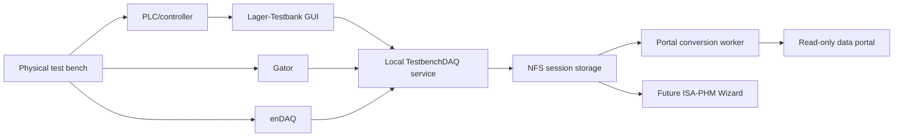

# TestbenchDAQ

TestbenchDAQ acquires external-sensor measurements from a test bench. It
coordinates a PhotonFirst Gator FBG interrogator and an enDAQ recorder on a
Linux acquisition host. It does not control the PLC; the Lager-Testbank GUI
coordinates PLC operation with the local DAQ service.

TestbenchDAQ preserves raw recorder files, derived per-sensor signal CSVs, and
an operational session manifest. It does not itself create a final ISA-PHM
dataset.

## Architecture



## Configuration model

Each standalone command combines two files:

- `machine.json`: local installed-hardware and storage configuration;
- `acquisition.json`: portable measurement schedule and sensor settings.

This prevents an experiment from changing machine identity, recorder mounting,
or where the host writes data. The GUI follows the same boundary: it sends the
acquisition request while the service retains the protected machine settings.

## Start here

The supported production path is Linux on AArch64 with Python 3.11 or newer.
Gator acquisition requires a separately distributed PhotonFirst runtime.

```bash
git clone https://github.com/NathanHouwaart/TestbenchDAQ.git
cd TestbenchDAQ
./scripts/install/setup_linux.sh --all
```

Then follow the [operator getting-started guide](docs/operator/getting-started.md).

Windows has an experimental Gator-only helper for local hardware validation;
see [the Windows helper guide](gator_recorder/windows/README.md).

## Documentation

Start with the operator documents when setting up or running a measurement:

- [Getting started](docs/operator/getting-started.md)
- [Machine and acquisition files](docs/operator/acquisition-files.md)

Engineering and deployment documents explain how the parts fit together:

- [Architecture and lifecycle](docs/engineering/architecture.md)
- [Local service and GUI integration](docs/engineering/local-service-and-gui.md)
- [Portal and shared storage](docs/engineering/portal-and-storage.md)
- [Deployment overview](docs/engineering/deployment.md)
- [Acquisition-session export contract](docs/contracts/acquisition-session.md)

## Development

The orchestration tests use simulated adapters and do not command hardware:

```bash
python -m unittest discover -s tests -v
python -m compileall -q tbdaq tests
```
